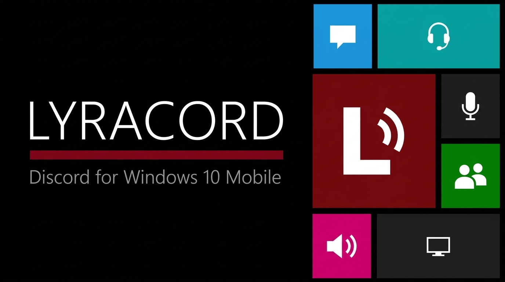

<p align="center">
  
</p>

<h1 align="center">Lyracord</h1>

<p align="center">
  <strong>Unofficial Windows Phone Metro Discord client with modern DAVE E2EE voice, DM calls, and Go Live stream viewing for Windows 10 Mobile &amp; Windows 10/11</strong>
</p>

<p align="center">
  <a href="https://github.com/lambdawesta/Lyracord/releases/latest"><strong>Latest Release (.appx)</strong></a>
  &nbsp;·&nbsp;
  <a href="https://t.me/lyracord"><strong>Telegram Community</strong></a>
  &nbsp;·&nbsp;
  <a href="LICENSE"><strong>MIT License</strong></a>
</p>

---

Lyracord is a fork of [Unicord](https://github.com/UnicordDev/Unicord) by Thomas May (WamWooWam), rebuilt and maintained by **lambdawesta** to keep **Windows 10 Mobile** (`10.0.15254`, ARM32 — e.g. Lumia 950 / 950 XL) running smoothly on modern Discord servers.

## Features

- **Modern Discord Voice (DAVE E2EE):** voice gateway v8, `aead_xchacha20_poly1305_rtpsize` transport encryption, and end-to-end encryption via Discord's open-source [libdave](https://github.com/discord/libdave).
- **Server Voice & Direct Message Calls:** join server voice channels or ring friends directly in 1-on-1 DMs and group DMs — with live participant tiles, join/leave chimes, speaking rings, VoIP audio route switcher (speaker / earpiece / headset / Bluetooth), and lock-screen background execution.
- **Go Live Stream Viewer:** H.264 Annex B + Opus over DAVE with RTCP NACK/RTX packet recovery, full-screen landscape playback, and in-stream mic mute & deafen controls.
- **Authentic Windows Phone Metro UI (AMOLED):**
  - Metro Start hub with accent-coloured tiles, live rolling friends tile, and active call tile;
  - Unified Windows Phone "Messaging" speech bubbles across both direct messages and server text channels (square avatars, role colours, Discord server tags `primary_guild`, stickers & attachments);
  - Full-screen Metro profile cards with banners, badges, server tags, live & recent activity, game widgets, connected accounts, and one-tap message/call/friend actions;
  - Instant search across servers, direct messages, and friends, plus **Add Friend**, incoming/outgoing request management, and **Join Server** by invite link;
  - Unified Metro settings, turnstile & feather animations, and optional **Rich Presence** (*Lyracord · Windows 10 Mobile*).
- **In-App GitHub Updates:** checks GitHub Releases automatically, syncs release notes on the *About* page, and downloads architecture-matched `.appx` updates directly to `Downloads`.
- **Languages:** English, Русский, and Українська (switchable on the sign-in screen and in Metro settings).
- **Performance & Privacy:** fast streaming `READY` parsing, lazy guild emojis/stickers, 50 MB capped local image cache with one-tap clear, DPAPI-encrypted background token copy, and clean diagnostic reports with no tokens or private keys.

> **Unofficial client.** Lyracord is not affiliated with, endorsed, or supported by Discord Inc. "Discord" is a trademark of Discord Inc. Discord's Terms of Service do not permit unofficial clients — use at your own risk.

## Installing on Windows 10 Mobile (Lumia)

1. Download the latest release files from [**Releases**](https://github.com/lambdawesta/Lyracord/releases/latest):
   - `Lyracord_<version>_ARM.appx`
   - `Lyracord.cer` *(only needed once on first install)*
   - `Lyracord_ARM_Dependencies.zip` *(extract and attach the `Microsoft.*.appx` files if your phone does not already have them)*
2. On your phone, enable **Developer Mode** and **Device Portal** (*Settings → Update & security → For developers*).
3. Open Windows Device Portal in your browser → **Apps → Apps manager → Install app**.
4. Select `Lyracord_<version>_ARM.appx`, attach `Lyracord.cer` (first install) and any missing dependency `.appx` files, then click **Go**.
5. Launch **Lyracord** and sign in with your Discord token (step-by-step instructions are included inside the sign-in dialog). Never share your token with anyone.

Future updates install cleanly right on top of existing Lyracord installs while keeping your sign-in and settings.

## Community & Support

- Telegram community: **[t.me/lyracord](https://t.me/lyracord)**
- Issues & feedback: **[GitHub Issues](https://github.com/lambdawesta/Lyracord/issues)**

## Project Layout

| Path | Description |
| --- | --- |
| `Lyracord/` | Main UWP app (C#, min contract `10.0.15063` / W10M `15254`). |
| `Lyracord.Package/` | Desktop packaging project (`Lyracord.Desktop`). |
| `Lyracord.Shared/` | Shared constants & interop models. |
| `Lyracord.Background/` & `Lyracord.Background.Tasks/` | Background notifications & live tile tasks. |
| `Libraries/DSharpPlus/` | Vendored DSharpPlus with Lyracord patches (fast `READY` reader, `primary_guild`, DM voice & `CALL_CONNECT`, friend/invite APIs, configurable `ClientBuildNumber`). |
| `Libraries/LocalPackages/` | Local NuGet feed containing the native C++/WinRT voice & stream module `Unicord.Universal.Voice` (`1.18.0`). |
| `tools/build.ps1` | Sideload build script for ARM (phones) and x64 (PCs). |
| `tools/branding/` | Procedural generator for Lyracord's geometric Metro icons & wordmarks. |
| `docs/` | Project branding assets. |

## Building from Source

Requirements:
- Visual Studio 2022 Build Tools (UWP workload, MSVC v143 C++ x64/ARM, CMake);
- Windows SDK `10.0.19041` (required for ARM32 UWP) and `10.0.22621` / `10.0.26100`;
- .NET Framework 4.7.2 targeting pack and .NET SDK;
- Self-signed code-signing certificate **`CN=Lyracord`** in `CurrentUser\My`.

Package identity: `Name="Lyracord"`, `Publisher="CN=Lyracord"`, `PublisherDisplayName="lambdawesta"`.

```sh
git submodule update --init --recursive
```

Build via the helper script (handles 8.3 short paths and `/m:1` for Windows Community Toolkit):

```powershell
powershell -ExecutionPolicy Bypass -File tools\build.ps1 -Platform ARM
# or -Platform x64
```

## License

MIT, see [LICENSE](LICENSE). Lyracord preserves the original Unicord copyright notice; third-party components and their licenses are listed in [THIRD-PARTY-NOTICES.md](THIRD-PARTY-NOTICES.md) and on the app's *About* page.
